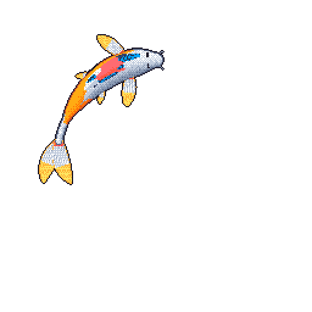
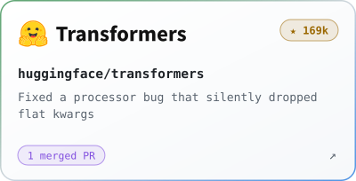
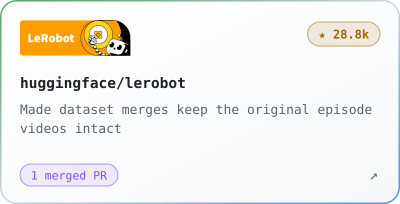
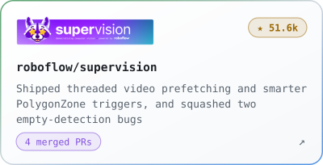
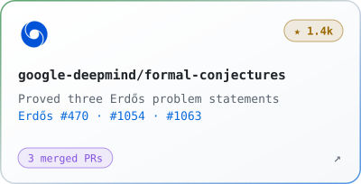
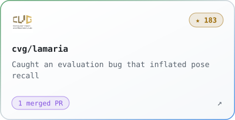

  

<!--  <h1 align="center">Hi, I'm <a href="https://mahbodtajdini.com/">Mahbod</a> 👋</h1> -->

  <a href="https://mahbodtajdini.com/">Portfolio</a> &nbsp;•&nbsp;
  <a href="https://www.linkedin.com/in/mahbodtajdini">LinkedIn</a> &nbsp;

---

- 🎓 &nbsp;MSc Computer Science student at **ETH Zürich** & **University of Zürich**
- 🇨🇭 &nbsp;Based in Zürich, Switzerland
- 🔬 &nbsp;Research interests span **3D computer vision**, **mixed reality**, and **robot perception**

 

🛠️ &nbsp;Open-source contributions

<a href="https://github.com/huggingface/transformers"><picture><source media="(prefers-color-scheme: dark)" srcset="contrib/transformers-dark.svg"></picture></a>
<a href="https://github.com/huggingface/lerobot"><picture><source media="(prefers-color-scheme: dark)" srcset="contrib/lerobot-dark.svg"></picture></a>

<a href="https://github.com/roboflow/supervision"><picture><source media="(prefers-color-scheme: dark)" srcset="contrib/supervision-dark.svg"></picture></a>
<a href="https://github.com/google-deepmind/formal-conjectures"><picture><source media="(prefers-color-scheme: dark)" srcset="contrib/formal-conjectures-dark.svg"></picture></a>

<a href="https://github.com/cvg/lamaria"><picture><source media="(prefers-color-scheme: dark)" srcset="contrib/lamaria-dark.svg"></picture></a>

<!-- 

  

 -->

  
  &nbsp;Open to collaboration ⟶ <a href="mailto:mahbodtajdini@gmail.com">Get in touch</a>

